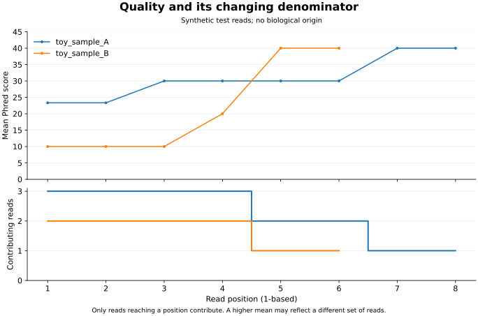

# Read quality with its denominator

Per-position means use only reads long enough to reach that position. The synthetic example demonstrates why the denominator belongs beside the quality curve: sample A falls from three contributing reads to one, while its mean Phred score rises. This does not show that the same reads improved.



The [public-prefix view](figures/fastq_public/cycle-context.svg) has 1,000 contributing reads at each of its 51 positions. It still describes only the first 1,000 archived reads, not the whole run or an observed error rate. Existing [FASTQ definitions](fastq-data-dictionary.md) and [public provenance](public-data.md) continue to apply.

## Reproduce the figures

The core QC commands still need only Python's standard library. In a separate optional plotting environment, install `requirements-visualization.txt`, then run from the repository root:

```sh
python -m pip install -r requirements-visualization.txt
python scripts/plot_fastq_qc.py --report-dir reports/fastq_synthetic --output-dir docs/figures/fastq_synthetic
python scripts/plot_fastq_qc.py --report-dir reports/fastq_public --output-dir docs/figures/fastq_public
```

Each command writes an editable SVG, a PNG preview, and `provenance.json` with the input-file hashes and plotting version. It replaces these three generated files in the selected output directory. The inputs and original QC reports stay unchanged. SVG labels can be edited in Inkscape, but regenerate numerical curves from the script and keep any presentation edits traceable.

Before plotting, the loader checks unique contiguous cycle positions, finite quality scores, non-increasing contributor counts, agreement with total bases, and agreement between the cycle-weighted mean and the saved overall mean within six-decimal rounding. These checks catch mismatched tables; they do not independently verify the FASTQ source. Run `python -m unittest discover -s tests -v` to check both existing QC behavior and these new boundaries.
